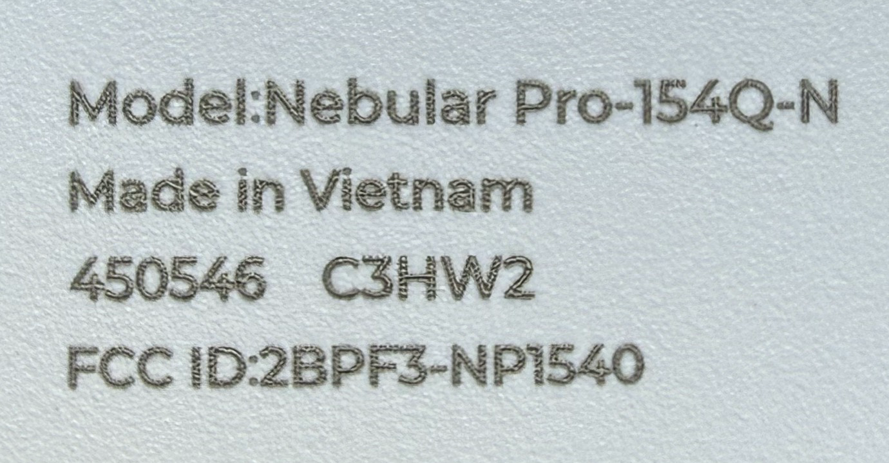
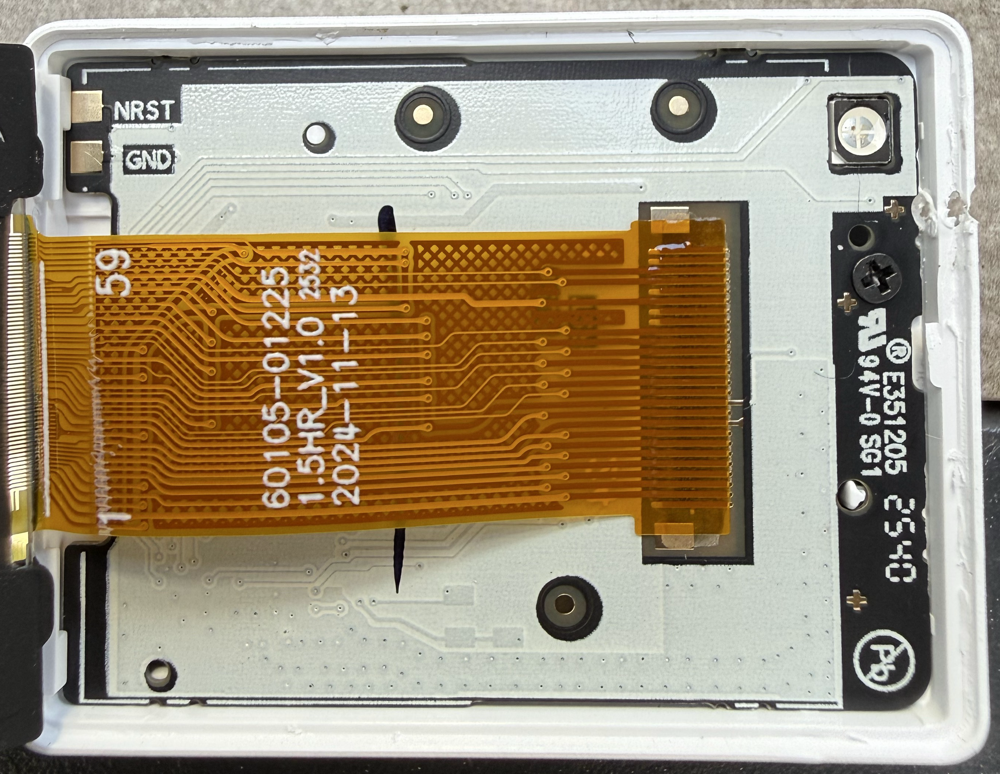
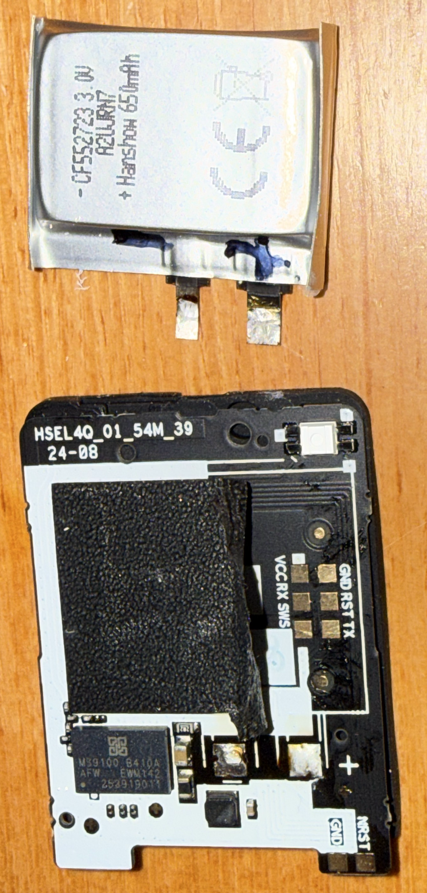

# Hanshow Nebular Pro-154Q-N — C3HW2

[All models](../../../README.md)

[Download the factory flash dump](factory-2026-10-03.bin) captured on 2026-10-03.

## Hardware

| Detail | Value |
| --- | --- |
| Model | Hanshow Nebular Pro-154Q-N |
| Case marking | `450546` |
| Case revision | `C3HW2` |
| FCC ID | `2BPF3-NP1540` |
| PCB | `HSEL4Q_01_54M_39` |
| MCU marking | `MS9100 B410A` |
| Native resolution | 200 × 200 pixels |
| Made in | Vietnam |
| Printed barcode | `514583053996242823` |
| Stored four-byte identifier | `EE31D387` |

## Capture and verification

The dump contains 524,288 bytes (512 KiB), covering `0x000000` through
`0x07ffff` inclusive. It was captured through SWS; the flash JEDEC ID was
`eb6013`. No flash programming, erase, or unlock commands were
issued during the capture.

Two independent full reads match byte for byte. Initial 4 KiB samples and
remote/local SHA-256 hashes also match; no transport faults were recorded.

SHA-256:

```text
9cac6e77d337412e99103bd8974a808f4d5782d01180077f6e2af71754fcef84
```

From the repository root, verify the downloads with:

```sh
sha256sum -c SHA256SUMS
```

Capture metadata is also recorded in the [manifest](../../../manifest.json).

## Provenance

Factory state was reported by the owner. Readback checks establish capture
consistency; OEM origin has not been independently authenticated. The stored
identifier matches the corresponding photographed printed barcode.

The dump retains original per-device identifiers, calibration, configuration,
and runtime data. Cross-device restoration has not been validated. The binary
is preserved byte for byte without redaction or modification.

Original OEM firmware remains attributed to its respective rights holders;
this repository grants no license to that firmware.

## Photos

Owner-supplied photos, cropped directly from the original JPEGs and saved as
lossless PNGs. Lettering and circuit details are preserved without retouching.
All photos are stored beside this specimen's dump.

### Model and case label

`Nebular Pro-154Q-N`, `450546`, `C3HW2`, `2BPF3-NP1540`; made in Vietnam.

<a href="photo-01-154q-n-label.png"></a>

### Panel flex and rear board

Flex markings: `60105-01225`, `1.5HR_V1.0`, `2024-11-13`. Pads: `NRST`, `GND`.

<a href="photo-02-panel-flex.png"></a>

### Board and battery

PCB `HSEL4Q_01_54M_39`, `24-08`; MCU `MS9100 B410A`; Hanshow `65 mAh`, `3.0 V` battery.

<a href="photo-03-154-board-battery.png"></a>
