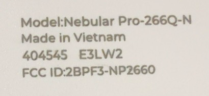
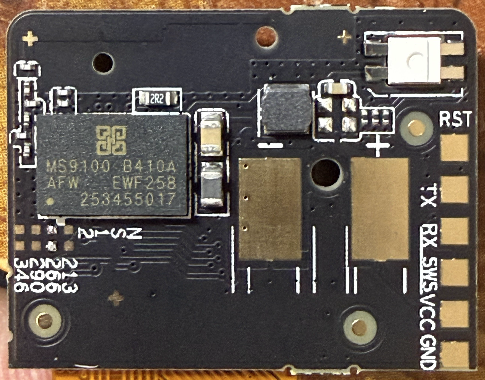
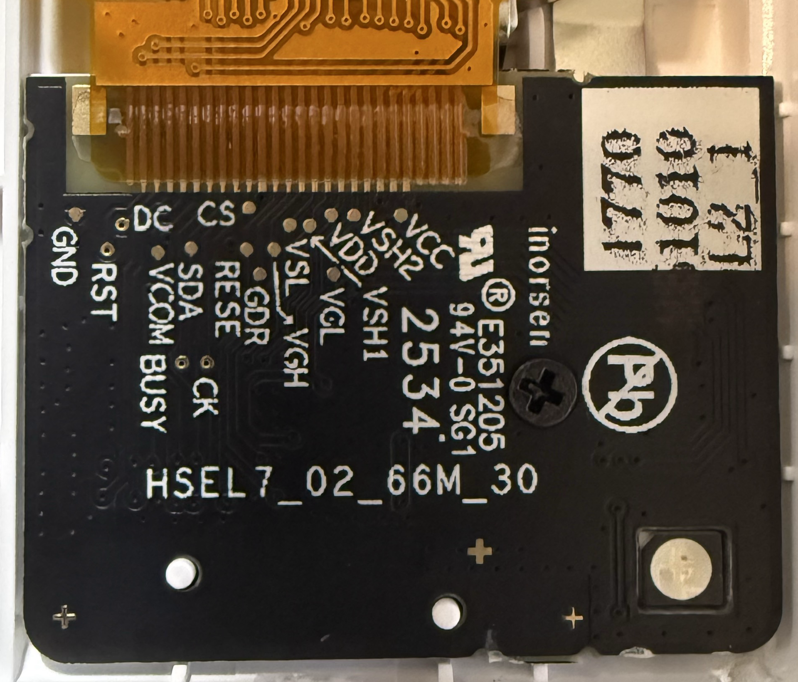

# Hanshow Nebular Pro-266Q-N — E3LW2

[All models](../../../README.md)

[Download the factory flash dump](factory-2026-09-28.bin) captured on 2026-09-28.

## Hardware

| Detail | Value |
| --- | --- |
| Model | Hanshow Nebular Pro-266Q-N |
| Case marking | `404545` |
| Case revision | `E3LW2` |
| FCC ID | `2BPF3-NP2660` |
| PCB | `HSEL7_02_66M_30` |
| MCU marking | `MS9100 B410A` |
| Native resolution | 152 × 296 pixels |
| Made in | Vietnam |
| Printed barcode | `343581053587707526` |
| Stored four-byte identifier | `D5D81286` |

## Capture and verification

The dump contains 524,288 bytes (512 KiB), covering `0x000000` through
`0x07ffff` inclusive. It was captured through SWS; the flash JEDEC ID was
`eb6013`. No flash programming, erase, or unlock commands were
issued during the capture.

One full read was checked against the initial sample and ten fresh 256-byte
reads across flash. Remote/local SHA-256 hashes match. On 2026-09-29, before
installing replacement firmware, a further 79,872-byte partial read and
38 independently read 256-byte samples matched this capture. A second complete
factory read was not performed.

SHA-256:

```text
b51bc02f5a163198117882d6b71f78d828c9c93b226f9bb49c1b7bb6f20e9f5f
```

From the repository root, verify the downloads with:

```sh
sha256sum -c SHA256SUMS
```

Capture metadata is also recorded in the [manifest](../../../manifest.json).

## Provenance

Factory state was reported by the owner. Readback checks establish capture
consistency; OEM origin has not been independently authenticated. The stored
identifier matches the corresponding photographed printed barcode.

The dump retains original per-device identifiers, calibration, configuration,
and runtime data. Cross-device restoration has not been validated. The binary
is preserved byte for byte without redaction or modification.

Original OEM firmware remains attributed to its respective rights holders;
this repository grants no license to that firmware.

## Photos

Owner-supplied photos, cropped directly from the original JPEGs and saved as
lossless PNGs. Lettering and circuit details are preserved without retouching.
All photos are stored beside this specimen's dump.

### Model and case label

`Nebular Pro-266Q-N`, `404545`, `E3LW2`, `2BPF3-NP2660`; made in Vietnam.

<a href="photo-06-266q-n-label.png"></a>

### MCU and programming pads

MCU `MS9100 B410A`. Pads: `RST`, `TX`, `RX`, `SWS`, `VCC`, `GND`.

<a href="photo-04-mcu-test-pads.png"></a>

### Panel board

PCB `HSEL7_02_66M_30`; panel signals include `DC`, `CS`, `RST`, `BUSY`.

<a href="photo-05-266-panel-board.png"></a>
